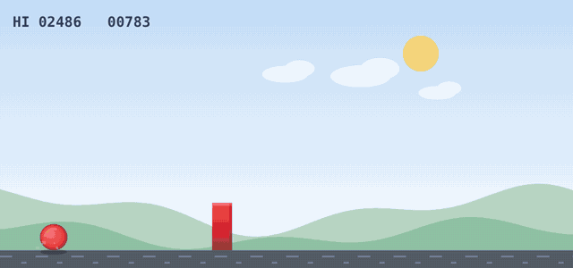
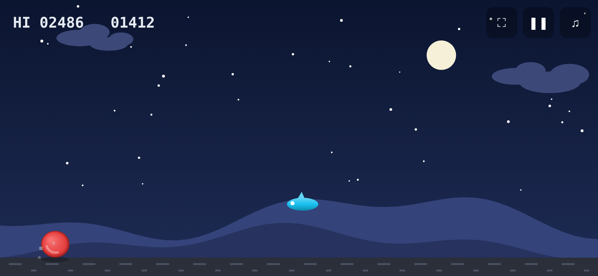
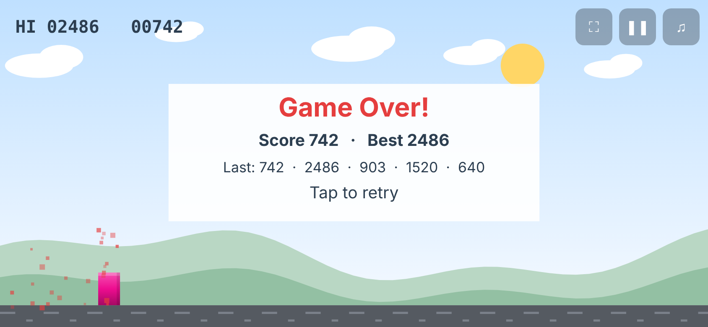

<div align="center">



# Pixel Jumper

**A tiny endless-runner game in one HTML file. Plays offline on PC and Android, and goes full screen on phones.**

<a href="https://digiRP2k25.github.io/pixel-jumper-game-offline/"></a>
<a href="https://github.com/digiRP2k25/pixel-jumper-game-offline/releases/latest"></a>


</div>

Jump over blocks, dodge flying obstacles, and survive as day turns to night. A tap gives a small hop, holding gives a big jump, and the game gets faster as your score climbs.

No install, no sign-up, no ads, and no internet needed once you have the file.

| On your phone? Scan to play | Night mode | Game over |
|:---:|:---:|:---:|
|  |  |  |

> ⭐ **Enjoyed it?** Star the repo so others can find it. Ideas, bugs or a high score to brag about? [Open an issue](https://github.com/digiRP2k25/pixel-jumper-game-offline/issues/new).

---

## Features

- **Works offline.** It's a single 27 KB file with no fonts, images, or sound files to download.
- **Full screen on mobile.** On Android the first tap switches to full screen and landscape. The game avoids the phone's notch and adapts to any screen shape.
- **Hold to jump higher.** A tap gives a small hop and holding gives a big jump, so you control the height.
- **Six obstacle types:** small, tall, double, triple, split blocks, and flying obstacles (stay on the ground for those).
- **Fair difficulty.** Obstacles are always spaced so they can be cleared, and the speed rises gradually.
- **Day/night cycle** with stars, moon, scrolling hills, and clouds.
- **Sound effects** generated in code, plus a short vibration on crash (Android).
- **Scores are saved.** Your best score and last 5 scores are kept on your device.
- **Same speed on every screen** (60, 90, 120 or 144 Hz).
- **Auto-pause** when you switch apps or rotate the phone.

## Controls

| Action | Phone / tablet | Keyboard | Mouse |
|---|---|---|---|
| Jump | Tap | `Space`, `↑`, `W` or `Enter` | Click |
| Jump higher | Hold the tap | Hold the key | Hold the button |
| Drop fast | Swipe down | `↓` or `S` | – |
| Pause / resume | ❚❚ button | `P` or `Esc` | ❚❚ button |
| Mute | ♫ button | `M` | ♫ button |
| Full screen | ⛶ button | `F` | ⛶ button |

## How to play

### In the browser (online)
Open the **Play online** link above. Works on phone, tablet, and desktop.

### Offline on a computer
1. Download `index.html` from the [latest release](https://github.com/digiRP2k25/pixel-jumper-game-offline/releases/latest).
2. Double-click it. It opens in your browser and plays with no internet.

### Offline on an Android phone
1. Copy `index.html` to the phone (USB cable, Google Drive, or send it to yourself on WhatsApp/email).
2. Open it with **Chrome** (from the Files app, tap the file and choose Chrome).
3. Tap once to go full screen, then tap again to start.

Tip: if you open the online link in Chrome and choose **⋮ → Add to Home screen**, you get a home-screen icon for quick access.

### iPhone / iPad
Open the online link in Safari. Safari doesn't allow web pages to hide the address bar, but the game fills the rest of the screen. Turn the phone sideways for the best view.

## Browser support

Any modern browser: Chrome, Edge, Firefox, Safari, Samsung Internet (2022 or newer).

## Project structure

```
pixel-jumper-game-offline/
├── index.html          ← the whole game (HTML + CSS + JavaScript)
├── README.md
├── CHANGELOG.md
├── LICENSE
└── docs/
    ├── demo.gif            ← animated gameplay at the top of this README
    ├── qr-play.png         ← QR code to the play-online page
    ├── social-preview.png  ← image shown when the repo link is shared
    └── screenshots/        ← still images used in this README
```

## Customizing

All the tuning values are near the top of the `<script>` in `index.html`, in the **CONSTANTS** section:

| Constant | What it changes | Default |
|---|---|---|
| `JUMP` | Launch speed of a jump | `10.5` |
| `HOLD_MAX` | How long holding keeps the ball rising (frames) | `14` |
| `GRAV` | Gravity | `0.8` |
| `MAX_SPEED` | Top running speed | `12` |
| `R` | Ball size (radius) | `15` |

Obstacle types and when they appear are in the `spawn()` function. The day and night colors are in the `DAY` and `NIGHT` palettes.

## Troubleshooting

- **No sound?** Check the mute button at the top-right. If it shows **✕**, click it or press **M**. The mute setting is remembered, and on a PC every game file you open from your disk shares it, so mute from an earlier session carries over.
- **No full screen on iPhone?** Safari doesn't let web pages hide the address bar. Turn the phone sideways for the biggest view.
- **Scores disappeared?** Scores are saved in your browser. Clearing browsing data or using private/incognito mode resets them.

## License

[MIT](LICENSE). You're free to use, change, and share it.

---

Made by **Raja Prabu** ([@digiRP2k25](https://github.com/digiRP2k25)).
